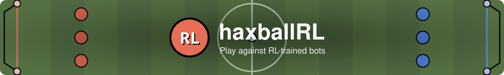

  

  
  &nbsp;
  

Play [HaxBall](https://www.haxball.com) against bots trained with reinforcement learning. Pick one of the bots, create a room, and play solo/with friends.

> More bots are in the making..

## How to use

1. **Download** the app for your system above and install it.
   * **macOS:** open the `.dmg` and drag haxballRL to Applications. The first time, right-click the app and choose **Open**.
   * **Windows:** run the installer. If Windows warns you, click **More info → Run anyway**.
2. **Pick a bot** (1v1 Classic or 3v3 Big) and press **Play**.
3. **Set a password and max players**, press **Create room**, and solve the quick captcha.
4. **Join with the link first** so you're the room owner. Drag bots and friends between the teams, then press **Start**.
